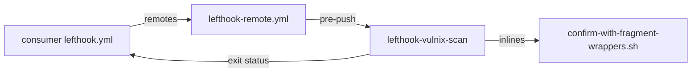
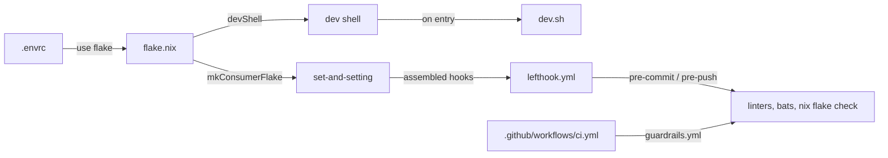

# nix-lefthook-vulnix-scan

<!-- hallucinogen:autonomy-disclaimer start -->
> Read [LLM-DISCLAIMER](docs/LLM-DISCLAIMER.md) first. This repository is
> tended by an autonomous loop, and that file says what the loop may do here,
> what it may not, and what to check before trusting anything in this tree.
<!-- hallucinogen:autonomy-disclaimer end -->

[](https://github.com/pr0d1r2/nix-lefthook-vulnix-scan/actions/workflows/ci.yml) [](https://nixos.org)

Lefthook-compatible vulnix vulnerability scanner for nix build results, packaged as a Nix flake.

Scans nix build result symlinks (`result-darwin`, `result`) for known CVEs using [vulnix](https://github.com/nix-community/vulnix). Supports project-specific whitelists.

## Architecture



## Usage

### As a remote lefthook configuration

The remote config registers vulnix-scan under `pre-push` only. It is not
available as a `pre-commit` hook because the scan requires nix build result
symlinks (`result`, `result-darwin`) which are not available at commit time.

```yaml
remotes:
  - git_url: https://github.com/pr0d1r2/nix-lefthook-vulnix-scan
    ref: main
    configs:
      - lefthook-remote.yml
```

### As a flake input

```nix
{
  inputs.nix-lefthook-vulnix-scan.url = "github:pr0d1r2/nix-lefthook-vulnix-scan";

  # In devShell packages:
  nix-lefthook-vulnix-scan.packages.${system}.default
}
```

## NVD cache

The `default` package uses the pre-built mirror at
`https://pr0d1r2.github.io/nix-vulnix-nvd-mirror/` and downloads the feed at
scan time. The `offline` package copies the pre-built `Data.fs` from
[nix-vulnix-nvd-mirror](https://github.com/pr0d1r2/nix-vulnix-nvd-mirror) to a
writable temporary directory and runs vulnix offline; use it for air-gapped
scans.

Set `VULNIX_MIRROR` to use a custom mirror. Retry settings apply to network
downloads only.

## Whitelists

- `.vulnix-whitelist.toml` — project-specific whitelist (tracked in git)
- `.vulnix-whitelist-system.toml` — system/CI whitelist (gitignored, copy from `.vulnix-whitelist-system.toml.example`)

```bash
cp .vulnix-whitelist-system.toml.example .vulnix-whitelist-system.toml
```

### Vendored Rust and Haskell dependencies

vulnix matches NVD records by derivation name and version. Vendored Cargo
crates and Hackage packages can therefore collide with an unrelated product
that happens to use the same name. Rust and Haskell dependencies should be
checked with RustSec (`cargo audit`) and the Haskell security database; NVD
matches for a colliding vendored package are not evidence that the crate or
library is affected.

For a reviewed collision, whitelist the package name without pinning a
version. This keeps a crate bump from requiring another whitelist entry:

```toml
["yoke"]
comment = "Rust crate; CVE refers to the unrelated Yoke Kubernetes deployer"
issue_url = ["https://github.com/advisories"]
```

The entry is still package-specific and should include the CVE(s) when the
exception is only valid for particular advisories. Do not use this form for a
real vulnerability in an application or runtime package.

## Configuration

| Variable | Default | Description |
| --- | --- | --- |
| `VULNIX_RESULTS` | `result-darwin result` | Space-separated list of result symlinks to scan |
| `VULNIX_WHITELIST` | `.vulnix-whitelist.toml` | Path to project whitelist file |
| `VULNIX_WHITELIST_SYSTEM` | `.vulnix-whitelist-system.toml` | Path to system whitelist file |
| `VULNIX_MIRROR` | project mirror | NVD feed mirror URL; override the default mirror |
| `VULNIX_RETRIES` | `3` | Network fallback retry attempts |
| `VULNIX_RETRY_DELAY` | `5` | Network fallback base delay (exponential backoff) |
| `LEFTHOOK_VULNIX_SCAN_TIMEOUT` | `120` | Outer timeout in seconds |

## Development

```bash
nix develop  # or use direnv via .envrc
bats tests/unit
```

### Development architecture



## License

MIT
